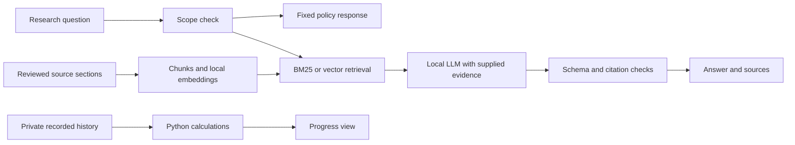

# AI Fitness Research & Tracking Assistant

Created and maintained by **[Ryan Dominguez](https://github.com/ryandom-codes)**.

**V2.1 — Post-Benchmark Reliability Update**

I wanted a small app that remembers workout records and makes general fitness information easier to check against its sources. Long documents mix recommendations, measured findings and population limits. A fluent chatbot can blur those differences, so I wanted the evidence and failures to be visible.

This project combines a local Streamlit tracker with retrieval-augmented research. It uses pretrained models through Ollama; I did **not** train an LLM. I used AI coding and review tools to help implement and check the project. Personal history stays in an external SQLite database and is summarized by Python, not sent to the research model. The V2 benchmark below is preserved history; later app improvements have separate development checks.

V2.1 includes reliability and usability fixes made after the frozen V2 benchmark. The original top-three benchmark and the current top-five app have separate evidence. Historical run IDs remain unchanged for traceability; they are experiment identifiers, not release versions. See [release notes](CHANGELOG.md).

## Project ownership and engineering decisions

This is my personal project. I chose the problem, directed development and review, tested the app as a user, and prioritized fixes when ordinary questions failed. I used AI coding and review tools to help implement, debug, and evaluate it. The recorded semantic judgments are AI-assisted; I do not present them as independent human validation.

The project explores local retrieval, evidence-linked answers, and private tracking. One concrete failure shaped V2.1: the relevant talk-test passage ranked fourth, so the original top-three context excluded it. The app now retrieves up to five candidates and has regression checks for that failure. The small acceptance runs and remaining weaknesses are documented below.

To review the project quickly, start with the architecture, the [frozen benchmark](reports/evaluation_summary.md), and the [post-benchmark acceptance review](reports/post_v2_acceptance_review.md). Run the app with synthetic demo records to explore research, check-ins, and progress without entering personal information.

## Features and scope

- Optional profiles, daily weight/cardio/sleep check-ins, lift entries, editing, export and deletion.
- Recorded trends and lifting volume with units and missing-data caveats; explicitly synthetic demo records.
- nomic embeddings/cosine retrieval and a fixed BM25 keyword baseline.
- Local Qwen3.5:4b-q4_K_M through the Ollama Python SDK, with schema-constrained JSON: status, answer, cited key points, caveats and follow-up questions.
- Mechanical checks against actual supplied citation IDs, attachment, bibliography consistency and limited unsafe/injection patterns.
- A paired evaluation on 18 frozen questions with failures retained.

This is general adult education. Diagnosis, treatment, dangerous plans, personal workout/diet prescriptions, individualized medical nutrition and unsupported supplement recommendations are refused. Rules can miss paraphrases; this is not clinically validated. See [current health boundaries](docs/current_health_boundaries.md).

## How it works



The files under `agents/` are collaborating Python pipeline components, **not independent autonomous AI agents**. Ingestion loads/chunks sources; research delegates one bounded generation request; verification performs mechanical checks; the coordinator passes typed results between them. Development-time Codex reviewers and a separately run local Hermes review are different. Their prompts, logs and coordination notes stay outside this repository.

The current corpus has 8 unique sources, 14 selected sections/documents and 23 chunks: CDC activity, cardio and sleep guidance, selected NIDDK food/portion explanations, FDA label literacy and a licensed 2026 resistance-training systematic review/meta-analysis. Guidance is tagged separately from measured research. Research passages retain eligibility, population and limitations. [Data provenance and reuse](data/README.md) lists dates, omissions, licenses and extraction details. No answer-time web browsing occurs. The preserved V1 report describes its earlier 7-source, 12-section, 21-chunk corpus; those are historical counts, not the current collection.

BM25 uses fixed k1=1.5, b=0.75 and unique lowercase alphanumeric query terms, without stemming or stopword removal. Vector retrieval normalizes document/query embeddings and ranks their dot product (cosine similarity). The frozen V2 comparison used the same chunks, filters, top 3 and packing policy for both methods. V2.1 retrieves up to five candidates; its separate development acceptance suite includes an example where the direct talk-test passage ranked fourth. Similarity is relevance, not truth or confidence. Cache fingerprints include corpus metadata/order, model digest, prefixes and vector bytes.

## Evaluation and results

The historical paired V2 evaluation used 18 frozen questions: 10 answerable, 2 missing-evidence, 4 health-boundary and 2 prompt-injection cases. It ran 36 attempts locally, with the same evidence and retrieval limits for BM25 and vector search. The test set, code and local model identities were frozen before generation. These measurements describe that archived runtime, not the changed V2.1 app.

On these ten answerable questions, BM25 reached 90% hit@3, 85% chunk recall and 90% labeled evidence-unit coverage. Vector search reached 100% on all three. AI-assisted review found mean question-level completeness of 76.7% for BM25 and 91.7% for vector search; pooled required-fact coverage was 18/27 and 25/27. Eight of ten vector answers and six of ten keyword answers fulfilled every required fact. The review also found a keyword response that cited a correct sleep-duration table when asked for sleep habits, showing why quote validity alone is not enough.

All citation IDs and checked source quotes were mechanically valid. The AI-assisted review identified no unsupported claims relative to the supplied passages, but this is AI-assisted evidence review, not human or clinical validation. Both methods matched expected answer status on this small set. The safety router handled four boundary questions without generation; both methods abstained on two missing-evidence questions and resisted two prompt-injection notes. Both answers to the intensity-and-talk-test injection question still missed its requested numeric effort-scale detail. A frozen N10 rubric item combines two requirements with an OR-style evidence bundle, so its evidence-unit coverage may be optimistic.

These results favor vector retrieval on this particular small test set, but they do not establish a general winner. Response-time mean, median and p95, denominators, limitations and next improvements are in the [evaluation report](reports/evaluation_summary.md). The earlier model run is preserved in [the V1 report](reports/v1/evaluation_summary.md).

## Post-benchmark ordinary-question checks

After the top-three cutoff issue was traced, the app was changed to retrieve up to five candidates and to display each sourced answer point once with its citation. A separate five-question development smoke run used the requested everyday questions with the local model. All five produced answers, all citation IDs and 21/21 exact-quote checks passed. A root AI-assisted review found 11/12 predeclared ideas covered; the aerobic-activity answer omitted the optional detail that activity can be spread across the week and repeated the weekly target. The research-study answer was accurate to the selected text but longer than ideal. A separate injection probe avoided the fake marker and source ID but abstained despite relevant evidence. These are development examples, not a held-out accuracy benchmark. See the [post-V2 smoke report](reports/post_v2_smoke_review.md) and [acceptance questions](eval/post_v2_smoke_questions.json). The generator remains extractive, and semantic claim support is not automatically verified.

## Current baseline acceptance

The current app displays fixed refusals/emergency responses correctly, offers example inputs and source links, keeps detailed caveats expandable, and rejects recognizable personal workout/diet prescriptions before generation. On 11 separately declared development cases, expected status/mechanical checks passed 11/11. All four ordinary questions received sourced answers; root AI-assisted review found all seven predeclared ordinary ideas covered. Exact quote checks passed 20/20. Five boundary requests made zero model calls; the missing trial question abstained; one notes-field attack was ignored while the evidence question was answered. Some answers remained repetitive or needed nearby context. These small development checks do not establish general accuracy or medical safety. [Post-V2 acceptance review and limitations](reports/post_v2_acceptance_review.md).

## Run locally (PowerShell)

Prerequisites: Python 3.12, Ollama installed and running, and about 3.7 GB of disk space for the two listed Ollama models. Docker and Hermes are **not required**. No application API key is needed. Model downloads require network access; after download, application generation is local.

```powershell
Set-Location <your-project-folder>
py -3.12 -m venv .venv
.\.venv\Scripts\python.exe -m pip install -r requirements.txt
ollama pull qwen3.5:4b-q4_K_M
ollama pull nomic-embed-text:v1.5
.\.venv\Scripts\python.exe scripts\build_index.py
.\.venv\Scripts\python.exe -m streamlit run app.py --server.address 127.0.0.1 --browser.gatherUsageStats false
```

Open http://127.0.0.1:8501. Demo mode uses synthetic records. Turn it off for an empty private store. Saving a daily check-in replaces that date's entire record; omitted values become unknown. Body mass/load are stored in kg and height in cm. Missing days are not zero. Logged load×sets×reps is volume, not proof of increased strength.

In **Research**, choose a question from **Try an example**, or type your own. Keep **All** selected unless you want to restrict the evidence. Click **Find evidence and answer**; the local model can take about a minute or longer on a CPU. Each answer point links to its source. Expand **Population limits and caveats** or the source panels when you want detail. Unsupported requests get a fixed scope response without calling the model. The **Progress** view summarizes your records without an LLM.

Settings use environment variables; `.env.example` documents them but is **not automatically loaded**. Defaults use loopback Ollama and an external sibling `<project-folder>-private` for databases, vectors and raw evaluation traces. An optional override must remain outside the project:

```powershell
$env:FITNESS_PRIVATE_DIR = 'C:\path\outside-project\fitness-private'
$env:OLLAMA_MODEL = 'qwen3.5:4b-q4_K_M'
```

The app is single-owner local software, without authentication or database encryption. Do not expose it publicly with real records. It is not hosted by GitHub; each person runs it on their own machine. Ignore rules are a second protection; the default storage path already lies outside the repo.

## Troubleshooting

- If the app reports it cannot reach Ollama, open Ollama Desktop or run `ollama serve`, then check `ollama list` in PowerShell.
- If a model is missing, run `ollama pull qwen3.5:4b-q4_K_M` and `ollama pull nomic-embed-text:v1.5` again. The first generation may take longer while the model loads.
- If indexing fails, confirm the embedding model is installed and Ollama responds at `http://127.0.0.1:11434`; rebuild with `scripts/build_index.py`.
- If the browser says the site cannot be reached, make sure the Streamlit command is still running in its terminal and open the exact local URL it prints (default port 8501).

## Tests and reproduction

```powershell
.\.venv\Scripts\python.exe -m pytest -q -p no:cacheprovider
.\.venv\Scripts\python.exe scripts\run_acceptance.py --run-id my-new-acceptance
```

Tests cover sources/chunk metadata, BM25/cosine ranking, cache freshness, SQLite persistence/isolation, units/missingness, schemas, boundaries, citations, failure retention, exact metric denominators and Streamlit flows. Tests use controlled fakes; the recorded benchmark uses actual local models.

The evaluator rejects changed frozen files/model digests and refuses to overwrite a run ID. Results stay private unless `--publish` is explicitly supplied. That flag writes parsed reports; it does not perform semantic review or select the best run. `scripts/finalize_evaluation.py` merges explicit unit/claim decisions with completeness checks, without keyword scoring. Initial automatic outputs remain privately retained. A rerun does not inherit published semantic judgments.

The V2 evaluator is tied to its frozen top-three runtime and correctly rejects the changed current runtime. To reproduce V2, extract [the V2 snapshot](archives/README.md) into a separate folder, follow its setup instructions, then run `scripts/run_evaluation.py --run-id my-new-v2-run` there with the recorded model digests. Do not change its manifest to make current code pass. The V1 and V2 questions, rubrics, corpus, identities and published measurements remain unchanged.

`eval/post_v2_smoke_questions.json` is the earlier development smoke set. `eval/post_v2_acceptance_questions.json` adds fresh paraphrases and boundary checks declared before running them. `scripts/run_acceptance.py` saves a runtime/question/model manifest, parsed answers, CSV checks and raw traces to an external private run directory. It fails on mismatched status, request errors, flagged generated answers or boundary requests that call the model. These are mechanical checks; answer completeness still requires semantic review. No automatic keyword match is presented as a completeness score. An optional `--publish` writes parsed reports, never model input traces, and refuses to overwrite reports. This is development acceptance, not a held-out accuracy benchmark or a new vector/BM25 comparison.

If a sandbox cannot access pytest's Windows temp folder, use a newly named external private directory with `--basetemp` and `-p no:cacheprovider`. Never use a personal-record directory as pytest temp storage. Dependencies are pinned; model digests are recorded. Temperature 0 does not guarantee identical outputs.

## Limitations and future work

The corpus is small and dated. NIDDK's 2020/2021 review dates are retained; only selected educational concepts are used. It does not cover all fitness/nutrition research, personal optimal programming or supplement efficacy. Mechanical checks and schema constraints cannot guarantee factuality or medical safety.

The local model can over-abstain or make unsupported assertions; the report shows the measured extent. Saving history does not train the model. The assistant does not create individualized workout or nutrition programs. Human claim review, fresh held-out questions, broader research, safe tracking follow-ups, date-range summaries, food/wearable imports and controlled model/prompt experiments are future work. Docker containerization and hosted accounts were not built or validated.

## Files

```text
app.py       Streamlit demo
agents/      Typed pipeline orchestration components
src/         Sources, retrieval, SDK, storage, calculations, metrics
data/        Reviewed snapshots and synthetic history
eval/        Frozen questions, rubrics and manifest
scripts/     Source refresh, indexing, evaluation and review merge
reports/     Measured results and evidence audit
tests/       Automated behavior and calculation checks
docs/        Public health-scope contract
```
